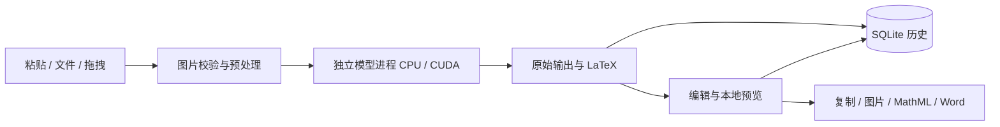

# Img2Tex · 本地公式识别

将公式图片转换为可编辑的 **LaTeX、MathML 和 Word 公式**。面向 Windows 的桌面应用，使用 **Xiaomi-OCR-0 在本机推理**，支持 CPU / CUDA 自由选择，日常识别、预览和导出可离线完成。

> 自行截图或复制图片 → 在窗口内按 **Ctrl+V** → 自动识别 → 编辑与预览 → 复制或导出。

## v2.0.0 更新

- **启动预加载与预热**：窗口显示后后台完成设备准备、权重加载和短推理预热；状态栏展示进度。就绪后复用同一个模型进程，减少首次粘贴时的加载等待。
- **界面调整**：保留「导入图片、粘贴图片、开始识别、取消」四个常用按钮；新增文件、视图、设置、帮助菜单。
- **设备设置与关于**：设备选择移入独立设置窗口，主界面不再展示模型目录、手动加载及下载控件；关于窗口显示版本和发行类型。
- **CPU Only 轻量版**：采用独立的纯 CPU 运行库，ZIP 约 **1.75 GB**、解压约 **2.50 GiB**，较 v1.0.0 CPU/CUDA 通用包缩小约 **52%**。仍包含完整 Xiaomi-OCR-0 权重，没有量化或替换模型。
- **完整版资源精简**：清理 Qt 调试资源及多余语言资源；CPU/CUDA 完整版 ZIP 约 3.63 GB，当前仅保留本地构建，**暂不上传 Release**。其首次启动优先检测可用 CUDA，初始化失败会说明原因并回退 CPU。
- **数据兼容**：保留历史、编辑内容和相对模型路径；CPU Only 版读取旧 CUDA 设置时会改用 CPU，失效的旧模型路径会明确提示并尝试完整随包模型。

已通过 **183 项测试及 9 项子测试**，并完成实际离线识别、界面、设备切换、PNG/MathML 复制与可编辑 DOCX 导出验收。性能测量、体积对比和验证边界见 [v2.0.0 验收记录](docs/v2-validation.md)。

## 功能

- **图片输入**：剪贴板粘贴、文件导入和拖拽；粘贴新图片后使用已预热模型识别，准备期间保留最新图片。
- **本地推理**：CPU 使用 float32，CUDA 使用 float16。完整版首次优先检测 CUDA，后续尊重设备选择；初始化失败会明确提示并回退 CPU。CPU Only 版不初始化 CUDA。
- **编辑与预览**：LaTeX 源码可编辑，本地 KaTeX 实时预览，模型原始输出单独保留。
- **直接复制**：LaTeX、MathML(Word)、PNG 三个分体按钮，点击箭头展开格式菜单。
- **默认 LaTeX 格式**：支持无附加、`$…$`、`$$…$$`、`\(…\)`、`\[…\]`、`equation`，选择后自动记住。
- **导出**：MathML、含可编辑 OMML 的 DOCX、PNG、SVG，以及受支持结构的 AsciiMath / Typst。
- **本地历史**：SQLite 保存图像、原始/编辑后公式、设备和推理参数，可搜索与恢复。
- **启动预加载**：窗口显示后后台加载并执行短推理预热，同一进程复用模型。
- **菜单与设置**：顶部保留四个常用操作；菜单提供导出、历史显示、设备设置和关于。
- **离线便携包**：包含模型、Python/Qt/PyTorch 运行时，无需另装 Python 或 conda。

应用不提供内置截图或全局快捷键。截图与复制图片由用户自行完成；`Ctrl+V` 在应用窗口内粘贴图片，编辑器的纯文本粘贴及 `Ctrl+C` 复制保持正常行为。

## 下载与运行

本次 [v2.0.0 Release](https://github.com/remph99/img2tex/releases/tag/v2.0.0) **仅发布 CPU Only 离线便携版**，无需分卷合并；CPU/CUDA 完整版暂不上传。原有 v1.0.0 发行保留。

| 下载 | 大小 | 内容 |
| --- | --- | --- |
| [Img2Tex-2.0.0-Windows-x64-Portable-cpuonly.zip](https://github.com/remph99/img2tex/releases/download/v2.0.0/Img2Tex-2.0.0-Windows-x64-Portable-cpuonly.zip) | 1.75 GB | 仅 CPU，包含完整模型及运行库 |
| [SHA256SUMS.txt](https://github.com/remph99/img2tex/releases/download/v2.0.0/SHA256SUMS.txt) | 校验清单 | 校验下载完整性 |

完整解压到可写目录，运行 `Img2Tex/Img2Tex.exe`。保留 `_internal`、`models`、`img2tex-runtime.json` 和 `portable.flag`；无需安装 Python、conda 或配置 CUDA。模型已随包提供，日常识别、预览和导出可离线完成。

```powershell
Get-FileHash -Algorithm SHA256 .\Img2Tex-2.0.0-Windows-x64-Portable-cpuonly.zip
# 将结果与 SHA256SUMS.txt 比对
```

从旧便携版升级时，先退出旧程序，将新版本完整解压到新目录；需要保留历史和设置时，备份旧版 `data` 后将其复制到新版 EXE 同级。不要把旧版运行库混入 CPU Only 目录。

GitHub 自动生成的 **Source code** 下载项只包含源码，不包含可运行应用和权重。

发行文件未签名。Windows 11 x64 为实测平台；Windows 10 22H2 及另一台干净、无 NVIDIA 驱动的机器尚待验收。完整版包含 CUDA 13.0 运行库，需支持 CUDA 13 的 NVIDIA R580 或更新驱动，以及 Turing（计算能力 7.5）或更新架构；无需安装 CUDA Toolkit/cuDNN。GTX 10 系列等旧架构和 AMD/Intel 显卡使用 CPU。CPU Only 版不包含 CUDA 运行库，更新驱动也不会使它获得 CUDA 功能。

建议 16 GB 内存、CUDA 显存 6 GB 以上（8 GB 更宽裕），并预留解压空间；这些是使用建议，不是已验证的最低配置。模型、图片尺寸和生成长度影响实际内存需求。依据：[NVIDIA CUDA 13.0 说明](https://docs.nvidia.com/cuda/archive/13.0.0/cuda-toolkit-release-notes/)。

## 使用方法

1. 打开应用，等待状态栏显示设备检测、加载、预热及就绪。随包模型自动定位；在「设置 → 计算设备」选择 CPU/CUDA，CPU Only 版只支持 CPU。
2. 自行截图/复制公式图片，在应用内按 **Ctrl+V** 或点击「粘贴图片」，自动开始识别。连续粘贴时只识别最新图片。
3. 修改 LaTeX，查看实时预览；成功识别自动写入历史，编辑内容同步保存。等待加载或识别时的手动编辑不会被结果覆盖。
4. 点击「复制 LaTeX」「复制 MathML(Word)」「复制 PNG」直接复制；用右侧箭头选择默认格式或其他导出项。

导入/拖入文件后使用「开始识别」，加载失败时从「设置 → 重新初始化模型」重试。「帮助 → 关于 Img2Tex」显示当前版本及发行类型。取消、恢复历史或切换设备会使旧任务失效，迟到结果不会覆盖当前内容。关闭主窗口会退出程序。

### 数据保存在哪里？

| 模式 | 历史、设置、日志与应用缓存 |
| --- | --- |
| 源码运行 | `%LOCALAPPDATA%\Img2Tex` |
| 便携版 | `Img2Tex.exe` 同级的 `data` |

便携版由同级 `portable.flag` 标识；请放在可写磁盘，退出后再备份或移动整个文件夹。随包模型使用相对路径，跟随程序迁移；旧版保存的有效外部模型路径继续兼容；失效时明确提示并尝试完整的随包模型。

历史数据库为 `history.sqlite3`，包含公式图像与源码。不要将使用过的 `data` 加入重新发行的压缩包。数据目录不可写时明确报错，不会切换到其他历史库。

## 从源码开发

需要 Windows x64、Git 和 conda。Python 开发、测试和打包使用独立 **`img2tex`（CUDA）或 `img2tex-cpuonly`（CPU）conda 环境**，禁用用户 site-packages。

```powershell
git clone https://github.com/remph99/img2tex.git
cd img2tex

# 创建环境并安装 CPU 版依赖
.\scripts\setup.ps1 -TorchBuild cpu
# 或使用 CUDA 13.0 版依赖，同样支持 CPU 模式
# .\scripts\setup.ps1 -TorchBuild cuda

conda activate img2tex-cpuonly  # 使用 CUDA 开发环境时改为 img2tex
python -s -m img2tex --check-device
python -s -m img2tex --download-model --model-dir .\models\xiaomi-ocr-0
python -s -m img2tex
```

setup 脚本默认将 CPU/CUDA 分别安装到 `img2tex-cpuonly` / `img2tex`；重新执行会重装所选环境的 PyTorch。核心版本：Python 3.12、PySide6 6.12.0、PyTorch 2.14.0、torchvision 0.29.0、Transformers 5.17.0，详见 [pyproject.toml](pyproject.toml) 和 [environment.yml](environment.yml)。

源码仓库不包含模型、conda 环境、构建目录或使用历史；GitHub 自动生成的 “Source code” 下载不包含可运行的软件及权重。

### 模型与离线推理

模型来自官方 [Xiaomi-OCR-0](https://github.com/xiaomi-research/Xiaomi-OCR-0)，模型仓库 `xiaomi-research/Xiaomi-OCR-0` 固定提交：

```text
bbd8cf8d21f256b3644b44cb860f3a7cecb93c30
```

权重约 1.75 GB，下载器分段续传并验证 SHA-256。下载是单独操作，不上传输入图片；权重、渲染器和字体准备完整后，日常使用不依赖识别 API。发行包已经包含这些文件。

默认优先使用项目/EXE 同级 `models\xiaomi-ocr-0`，旧版自定义目录保持兼容，新界面不展示模型目录控件。没有匹配固定版本清单的模型，其历史版本标识为 `local-unverified`。

## 工作流与目录



| 路径 | 内容 |
| --- | --- |
| `src/img2tex/ui/` | 桌面界面、本地渲染与剪贴板交互 |
| `src/img2tex/engine.py` | 推理进程、设备选择、取消与任务隔离 |
| `src/img2tex/model_setup.py` | 固定模型版本、下载与完整性校验 |
| `src/img2tex/exports.py` | 公式格式转换与导出 |
| `src/img2tex/storage.py` / `paths.py` | 历史设置、安装与便携路径 |
| `scripts/` / `packaging/` | conda 环境、Windows 构建与发行工具 |
| `tests/` / `docs/` | 回归测试、工作流与验收记录 |

## 测试与构建

```powershell
conda activate img2tex
$env:QT_QPA_PLATFORM='offscreen'
$env:QT_OPENGL='software'
$env:QTWEBENGINE_CHROMIUM_FLAGS='--disable-gpu --disable-gpu-compositing'
python -s -m pytest -q
python -s -m ruff check src tests scripts
```

完成离屏测试后，关闭该终端或移除上述 Qt 测试变量，再启动可见桌面。

```powershell
# 正常 conda 终端中验证实际模型
python -s -m img2tex --smoke .\tests\fixtures\energy.png --device cpu --max-tokens 96 --output .\artifacts\cpu.json
python -s -m img2tex --smoke .\tests\fixtures\energy.png --device cuda --max-tokens 96 --output .\artifacts\cuda.json

# 分开构建，需已准备完整模型
.\scripts\build.ps1 -Edition full
.\scripts\build.ps1 -Edition cpuonly
python -s scripts/release.py --edition full --portable-only
python -s scripts/release.py --edition cpuonly --portable-only

```

正式便携发行包见 Releases；`dist` 是构建中间目录。版本唯一来源为 `src/img2tex/__init__.py`。

v1.0.0 曾通过 **170 项测试及 9 项子测试**，并在本机验证离线 CPU/CUDA 真实识别、便携目录迁移、历史与设置保留，以及可见界面的预览、复制和粘贴自动识别。分卷合并脚本另有发行工具检查。v2.0.0 的最新体积、时序和验收范围见 [v2 验收](docs/v2-validation.md)。旧版证据见 [发行验收](docs/distribution-validation.md)、[功能验收](docs/validation.md)、[工作流](docs/workflow.md)。

## 兼容范围与限制

- MathType 通过 MathML 导入，本机 MathType 7.8 验证过基础公式；不直接生成 MTEF/OLE 对象。
- DOCX 内含可编辑 OMML；剪贴板 MathML 与 DOCX 导出是不同链路，粘贴效果取决于接收软件。
- AsciiMath/Typst 只覆盖支持的常见结构，无法保真时明确报错，不是完整 LaTeX 编译器。
- 输入最长边最多缩至 2048，限制 50 MiB / 4000 万像素；识别结果需核对，尚无大规模手写、模糊图片或复杂公式精度承诺。
- 未在另一台干净 Windows 或无 NVIDIA 驱动的实体机器验收；本机 CPU 测试包含隐藏 CUDA 设备的检查。
- 当前不包含 PDF 整页解析、批量识别、云账号、翻译、AI 编辑和自动更新。

## 第三方组件

推理模型采用 Xiaomi-OCR-0；界面采用 PySide6/Qt，预览采用 KaTeX/MathJax，转换使用 latex2mathml、mathml2omml 与 python-docx。感谢各上游项目。

第三方组件各自遵循其许可证；模型为 Apache-2.0，其他许可和原始文本见 [THIRD_PARTY_NOTICES](packaging/THIRD_PARTY_NOTICES.txt)、[导出依赖说明](docs/export-notices.md) 及发行目录中的许可证。项目当前未另行声明自身源码的开源许可证。
