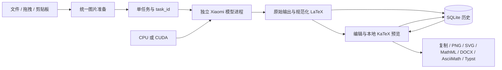

# 本地公式识别工作流

## 来源与边界

SimpleTex 0.2.12 的 REA 分析保存在 `analysis/simpletex-2026-11-01/01-simpletex-workflow.md`，包含文件身份、调用位置、运行观察与未确认项。其主要可复用产品流程是统一图像入口、识别任务、LaTeX 编辑、预览、格式复制和历史。该安装包的核心图片入口调用远程网关；本项目独立实现桌面与转换逻辑，将核心识别替换为本地 Xiaomi-OCR-0，没有复用厂商代码、二进制或网关。

## 数据流

输入在 `images.py` 校正 EXIF、合成白底、转 RGB 并生成无损 PNG。保留原尺寸 PNG 与送模图哈希，送模长边最多 2048。GUI 只传图像和任务参数给常驻的独立进程，避免加载模型或生成 token 阻塞界面。

`engine.py` 用 spawn 启动进程。CPU 明确 float32，CUDA 明确 float16；只读取本地模型，禁用远程模型代码。固定公式提示词，关闭思考和随机采样，仅解码新生成 token。结果保留原始文本；规范化只移除完整匹配的外层数学定界符和代码围栏，不做公式猜测修正。

每次识别使用唯一 task_id。新图片、历史恢复、取消、目录或设备切换都会使旧任务失效。迟到输出无法覆盖当前编辑或写入成功历史。用户在推理期间编辑源码时，完成结果进入历史，但不覆盖用户刚修改的编辑区。

剪贴板图片（含复制的本地图片文件）粘贴成功后自动启动识别，必要时加载选定的本地模型。加载中或旧任务物理取消中只保留最新一次粘贴；GUI 等待 worker 的 `is_busy` 清除后再提交，避免旧结果被过滤但新任务抢跑。取消、恢复历史或更换图片会清除待识别请求，模型/下载失败后不循环重试。文件导入和拖拽仍保留手动识别。

`storage.py` 是设置和历史的唯一持久化入口。原始输出、规范化源码和编辑源码分开保存；历史恢复同时恢复图像与编辑值。失败、空结果和取消均不伪装为成功记录。

## 本地显示和导出

`ui/preview.py` 在受限的 Qt WebEngine 页面中加载随应用分发的 KaTeX/MathJax/字体，拦截公网请求。LaTeX 通过 JSON 字符串传给渲染器；显示错误保留源码。PNG 裁剪公式实际边界，SVG 导出自包含路径，拒绝活动链接。

`exports.py` 从 LaTeX 转 MathML，再按受支持结构转换 AsciiMath、Typst 或 Word OMML。所有目标共享结构校验；不支持的语义明确拒绝，避免静默丢掉操作数。MathML 用文本及 MIME 复制以供 MathType 粘贴，DOCX 则写入 Word 原生可编辑 OMML，不依赖远程 DOCX 转换服务。

复制区使用三个分体按钮：主区域直接复制 LaTeX / MathML(Word) / PNG，箭头打开对应菜单。LaTeX 六种定界格式由独占菜单选择，SQLite 的 `latex_wrapper` 保存默认值，复制时加到编辑源码外层；原始输出、历史和编辑源码本身不变。

## 设备和部署

模型目录和设备选择保存在 SQLite。切换设备先停止旧进程，再显式加载。下载器固定模型提交、分段续传并校验权重哈希，与识别分开。源码开发使用独立 conda 环境 `img2tex`；PyInstaller 文件夹包含 Python、Qt、PyTorch 和静态资源，权重放在 EXE 同级模型目录。

`paths.py` 统一决定程序根目录、数据目录与模型路径序列化。安装版沿用 `%LOCALAPPDATA%\Img2Tex`；EXE 同级存在 `portable.flag` 时，历史、设置、日志和应用缓存改为同级 `data`。随程序携带的模型设置保存相对路径，外部模型保留绝对路径；数据目录不可写时明确报错，不回退到其他数据库。发行脚本将同一干净运行时分别封装为 Inno Setup 当前用户安装包和 ZIP64 便携包，避免夹带开发历史。

用户在实现过程中明确调整了输入方式：不需要全局截图/粘贴快捷键，截图及复制图片由用户完成。当前应用不提供内置截图，不注册全局热键，窗口内 `Ctrl+V` 粘贴图片；编辑器内文本粘贴与 `Ctrl+C` 文本复制保持正常。旧版本保存的快捷键值不再读取；它们不会改变当前行为。
